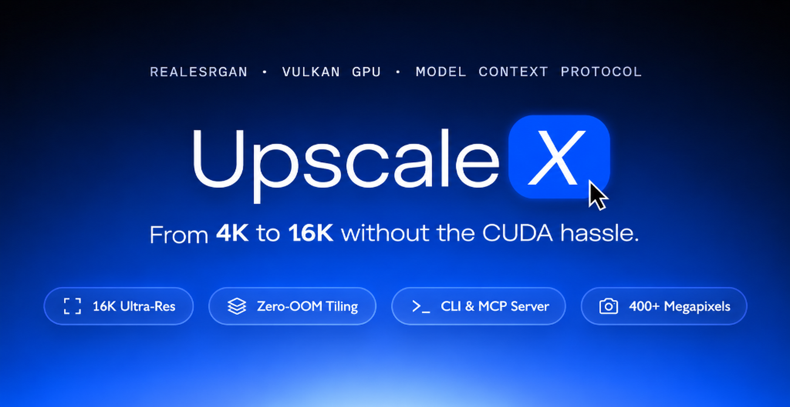
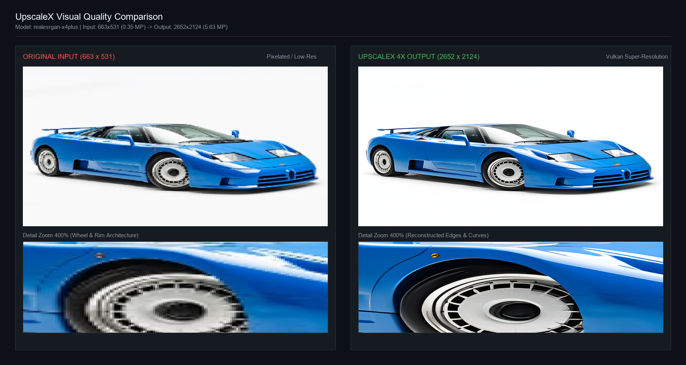

<p align="center">
  
</p>

# UpscaleX MCP/CLI

<!-- mcp-name: io.github.the-open-source-founder/upscalex -->

[](https://pypi.org/project/upscalex/)
[](LICENSE)
[](https://www.python.org/downloads/)
[](https://modelcontextprotocol.io)
[](https://www.khronos.org/vulkan/)

UpscaleX is a production-grade 8K and 16K image upscaler CLI and Model Context Protocol (MCP) server powered by RealESRGAN, Vulkan GPU hardware acceleration, and Lanczos supersampling.

Engineered for digital print workflows, large-format poster production, fine art reproductions, and autonomous AI coding agents in Claude Desktop, Antigravity, and Cursor.

> Looking for quick setup? Read the [Installation Guide](INSTALLATION.md) for a copy-paste AI Agent setup prompt and manual instructions, or provide your AI coding assistant with the [UpscaleX Agent Skill](SKILLS.md).

---

## Table of Contents

- [Key Features](#key-features)
- [Installation Guide](INSTALLATION.md)
- [AI Agent Skill](SKILLS.md)
- [Visual Quality Comparison](#visual-quality-comparison)
- [Documentation Directory](#documentation-directory)
- [Quickstart with uv](#quickstart-with-uv)
- [Command-Line Interface](#command-line-interface)
- [Model Context Protocol (MCP) Integration](#model-context-protocol-mcp-integration)
- [Model Matrix](#model-matrix)
- [Testing and Verification](#testing-and-verification)
- [Contributing](#contributing)
- [License](#license)

---

## Key Features

- **Dual-Mode Operation**: Interactive command-line interface (`upscalex`) and standard Model Context Protocol server (`upscalex-mcp`).
- **8K and 16K Presets**:
  - **16K**: Native 4x RealESRGAN deep-learning model upscale producing master files up to 400+ Megapixels.
  - **8K**: 4x deep-learning inference followed by Lanczos-3 downsampling (Supersampling Anti-Aliasing / SSAA) for sharp edges and zero noise.
  - **Custom Dimensions**: Proportional scaling to arbitrary resolutions or physical print aspect ratios.
- **Cross-Platform Architecture**: Tested and supported across **Windows**, **Linux** (Ubuntu, Debian, Fedora), and **macOS** (Apple Silicon arm64 & Intel x86_64).
- **GPU Acceleration with Seamless CPU Fallback**: Automatically discovers and utilizes discrete Vulkan GPUs (NVIDIA RTX/GeForce, AMD Radeon, Intel Arc/Iris, Apple Silicon via MoltenVK). In headless Docker containers or environments without GPU drivers, the engine falls back to multi-threaded CPU Lanczos super-resolution with zero crashes.
- **Hardware Diagnostics**: Integrated `upscalex doctor` command inspects system compute devices, Vulkan support, and recommended tile dimensions.
- **Memory-Safe Tiling**: Sliding-window spatial tile decomposition (`--tile-size 256`) processes ultra-gigapixel images without Out-Of-Memory (OOM) failures on 4GB to 8GB GPUs.
- **Automated Engine Provisioning**: Downloads and validates the precompiled platform binary automatically if not found locally.
- **Print Fidelity Analysis**: Automatically calculates physical print dimensions in inches and centimeters at 300 DPI, 150 DPI, and 72 DPI.

---

## Visual Quality Comparison

Below is an empirical comparison demonstrating UpscaleX 4x super-resolution reconstruction on a low-resolution pixelated source (`663 × 531` px, 0.35 MP) upscaled to high-definition print fidelity (`2,652 × 2,124` px, 5.63 MP) using the `realesrgan-x4plus` model.

<p align="center">
  
</p>

| Metric | Original Source | UpscaleX 4x Output |
| :--- | :--- | :--- |
| **Pixel Dimensions** | `663 × 531` | **`2,652 × 2,124`** |
| **Total Megapixels** | 0.35 MP | **5.63 MP** (16× Pixel Multiplication) |
| **Edge Reconstruction** | Heavy block pixelation, ringing | Reconstructed circular spokes, sharp contours |
| **Max 300 DPI Print Size** | 2.2 × 1.8 inches | **8.8 × 7.1 inches** |
| **Model** | — | `realesrgan-x4plus` |
| **Hardware** | — | NVIDIA GeForce RTX 3050 Laptop GPU (10.8s) |

---

## Documentation Directory

Comprehensive technical guides are available in the [`docs/`](docs/) directory and repository root:

- [Installation Guide](INSTALLATION.md): AI Agent autonomous copy-paste prompt and manual installation procedures.
- [AI Agent Skill Specification](SKILLS.md): Standard agent skill definition for Claude, Cursor, and Antigravity.
- [CLI Reference Guide](docs/cli-guide.md): Complete flag documentation, tiling strategies, and execution examples.
- [Model Context Protocol (MCP) Guide](docs/mcp-guide.md): JSON-RPC tool contracts, parameter schemas, and multi-client configuration.
- [Architecture & Mathematics Specification](docs/architecture.md): Deep-learning foundations, RRDB networks, Lanczos kernels, and memory bounds.
- [Error Handling & Troubleshooting](docs/troubleshooting.md): Known failure modes, pre-flight sanitization, and recovery procedures.
- [Contributing Guide](CONTRIBUTING.md): Code standards, test procedures, and pull request workflow.

---

## Quickstart

### Option 1: Install from PyPI (Simplest for CLI & MCP)

```bash
pip install upscalex
```

### Option 2: Clone and Install from Source (with uv)

```bash
git clone https://github.com/The-Open-Source-Founder/upscalex.git
cd upscalex

# Create virtual environment and install package
uv venv
uv pip install -e .
```

### Inspect Available Models

```bash
upscalex models
```

---

## Command-Line Interface

### 16K Upscale (Default 4x Model)

```bash
upscalex upscale input.png --target 16k
```

### 8K Supersampled Upscale

```bash
upscalex upscale poster.png --target 8k -o poster_8k.png
```

### 2D Illustration / Anime Artwork

```bash
upscalex upscale graphic.png --model realesrgan-x4plus-anime --target 8k
```

### Image and Print Sizing Inspection

```bash
upscalex info input.png
```

### Hardware and Content-Aware Model Recommendation

```bash
upscalex recommend input.png
```

For complete options and arguments, see the [CLI Guide](docs/cli-guide.md).

---

## Model Context Protocol (MCP) Integration

UpscaleX runs as a native MCP server over `stdio`, enabling AI agents (Claude Desktop, Cursor, Antigravity, Windsurf, Zed) to inspect image metadata, evaluate print viability, and execute upscaling autonomously.

### Server Invocation

```bash
# Standalone entrypoint
upscalex-mcp

# Or via CLI
upscalex serve
```

### Client Configuration

#### Method 1: Using Pip (`pip install upscalex`)

##### A. Claude Desktop
Configuration file paths:
- **Windows**: `%APPDATA%\Claude\claude_desktop_config.json`
- **macOS**: `~/Library/Application Support/Claude/claude_desktop_config.json`
- **Linux**: `~/.config/Claude/claude_desktop_config.json`

```json
{
  "mcpServers": {
    "upscalex": {
      "command": "upscalex-mcp"
    }
  }
}
```
*Note: If your environment does not have global pip binaries in PATH, use explicit Python:*
```json
{
  "mcpServers": {
    "upscalex": {
      "command": "python",
      "args": ["-m", "upscalex.server"]
    }
  }
}
```

##### B. Default / Common MCP Clients (Cursor, Antigravity, Windsurf, Claude Code)
Configuration file: `mcp_config.json` or `.cursor/mcp.json`

```json
{
  "mcpServers": {
    "upscalex": {
      "command": "upscalex-mcp"
    }
  }
}
```

---

#### Method 2: Using Git Clone & Source Checkout

##### A. Claude Desktop (with uv or virtualenv)
```json
{
  "mcpServers": {
    "upscalex": {
      "command": "uv",
      "args": [
        "run",
        "--directory",
        "/absolute/path/to/upscalex",
        "upscalex-mcp"
      ]
    }
  }
}
```
*Direct virtual environment alternative (Windows / Linux / macOS):*
```json
{
  "mcpServers": {
    "upscalex": {
      "command": "/absolute/path/to/upscalex/.venv/bin/python",
      "args": ["-m", "upscalex.server"]
    }
  }
}
```
*(On Windows, use `C:\\absolute\\path\\to\\upscalex\\.venv\\Scripts\\python.exe`)*

##### B. Default / Common MCP Clients (Cursor, Antigravity, Windsurf)
Configuration file: `mcp_config.json` or `.cursor/mcp.json`

```json
{
  "mcpServers": {
    "upscalex": {
      "command": "uv",
      "args": [
        "run",
        "--directory",
        "/absolute/path/to/upscalex",
        "upscalex-mcp"
      ]
    }
  }
}
```

For complete tool schemas and JSON-RPC contracts, see the [MCP Guide](docs/mcp-guide.md).

---

## Model Matrix and Catalog

UpscaleX supports both pre-packaged core models and on-demand downloadable community models:

| Model ID | Scale | Target Media | VRAM Requirement | Status | Description |
| :--- | :--- | :--- | :--- | :--- | :--- |
| `realesrgan-x4plus` | 4x | Photos / Fine Art | Medium (4GB VRAM) | **Installed** | Flagship model for high-fidelity photography, art, and exhibition posters. |
| `realesrgan-x4plus-anime` | 4x | Anime / Illustration | Medium (4GB VRAM) | **Installed** | Preserves flat colors, sharp contours, and line definition in 2D illustrations. |
| `realesr-animevideov3-x4` | 4x | Video / Fast Previews | Low (1GB-2GB / CPU) | **Installed** | Lightweight 4x feed-forward model for fast turnaround and low-spec systems. |
| `realesr-animevideov3-x2` | 2x | Animation / Video | Low (1GB-2GB / CPU) | **Installed** | Fast 2x model for video frames, icons, and lightweight web assets. |
| `realesr-animevideov3-x3` | 3x | Animation / Video | Low (1GB-2GB / CPU) | **Installed** | Fast 3x model for intermediate scaling. |
| `realesr-general-x4v3` | 4x | General / Compact | Low (2GB VRAM) | **Installed** | Official compact general model with low memory consumption. |
| `4x-ultrasharp` | 4x | Portraits / Ultra-Detail | Medium-High (4GB-6GB) | Downloadable | Community champion for micro-textures, portraits, fabrics, and skin. |
| `4x-nmkd-superscale` | 4x | Clean Photorealistic | Medium-High (4GB-6GB) | Downloadable | Trained on clean photography; preserves hair, threads, and foliage. |
| `realesrgan-anime-6b` | 4x | Anime / Fast | Low (1GB-2GB / CPU) | Downloadable | 6-block lightweight anime model for rapid processing. |

### Download Additional Models

Download models through the CLI or via the `download_model` MCP tool:

```bash
# Download 4x UltraSharp for portraits
upscalex download-model 4x-ultrasharp

# Download NMKD clean photo model
upscalex download-model 4x-nmkd-superscale
```

---

## Testing and Verification

Run the test suite to verify model resolution calculation, CLI exit codes, and live GPU inference:

```bash
uv pip install -e ".[dev]"
uv run pytest -v
```

All tests must pass prior to submitting changes.

---

## Contributing

Contributions to UpscaleX are welcome. Please read [CONTRIBUTING.md](CONTRIBUTING.md) for coding standards, pull request processes, and development guidelines.

---

## License

This project is licensed under the MIT License. See the [LICENSE](LICENSE) file for details.
